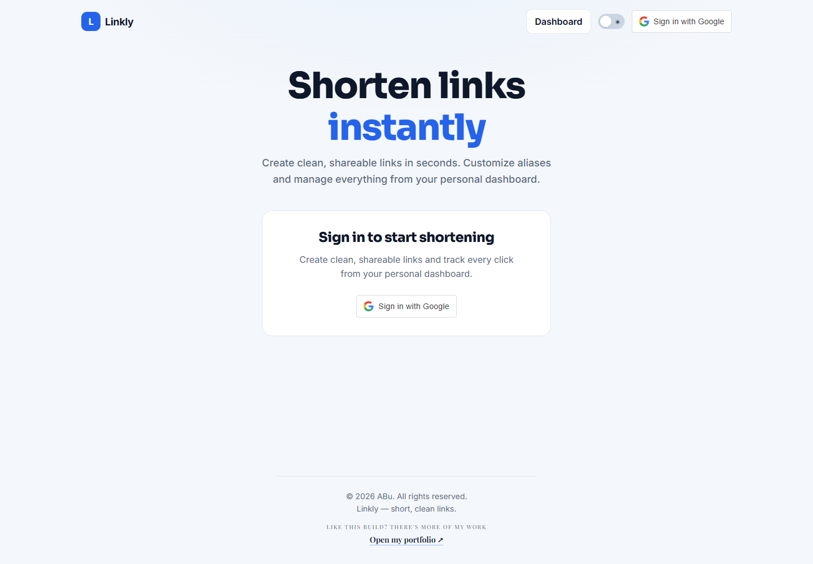
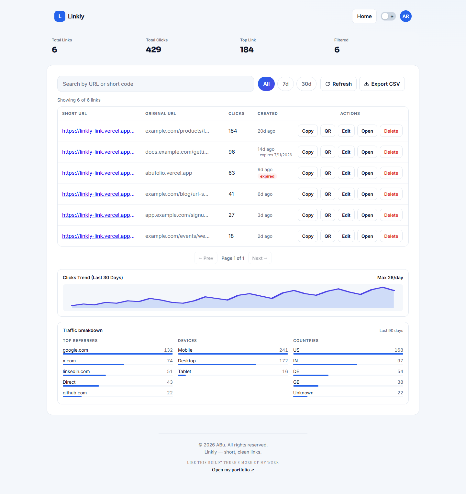
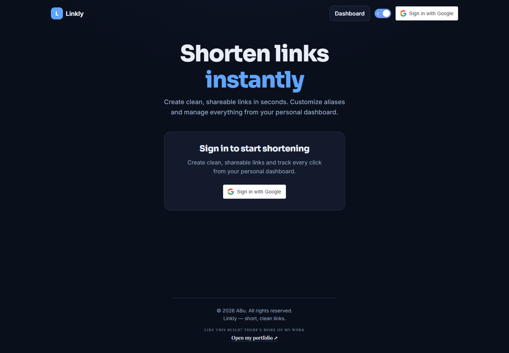
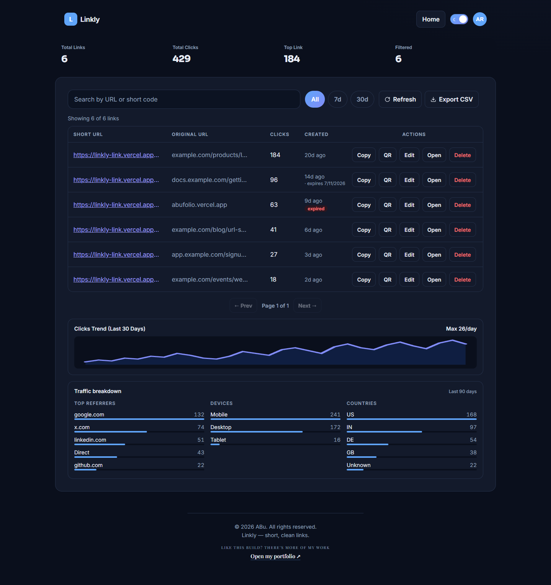
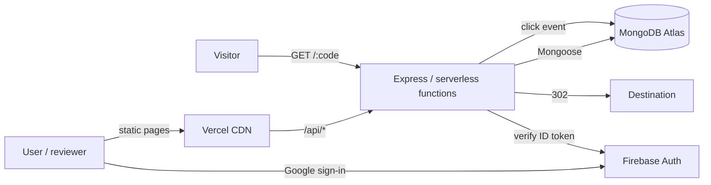

# Linkly — Link management & analytics platform

Branded short links, privacy-conscious click analytics, QR codes, and a documented REST API — built on Node.js/Express, MongoDB and Firebase, deployed on Vercel.

[](https://linkly-link.vercel.app)
[](https://linkly-link.vercel.app/dashboard.html?demo=1)
[](https://github.com/abustark/linkly/actions/workflows/ci.yml)


> **Try it without an account:** open the [live demo dashboard](https://linkly-link.vercel.app/dashboard.html?demo=1). It renders a seeded sample workspace entirely in the browser — no sign-in, no writes.

> 📄 **[`PROJECT-INFO.md`](PROJECT-INFO.md)** — machine-readable project facts (stack + exact versions, architecture, metrics, keyword tags) designed so an AI can generate resume entries and portfolio summaries from it alone.

## Overview

Linkly turns long URLs into short, shareable links and tracks how they perform. Users sign in with Google, create links with optional aliases and expiration dates, and manage everything from a dashboard — search, filter, edit destinations, inspect 30-day trends and traffic breakdowns, download QR codes, and export CSV. Developers can automate the same workflows through a public REST API with revocable, hashed API keys.

**A URL shortener is the demo; the platform behind it is the point.** The interesting parts are the analytics pipeline, the abuse controls, the API-key lifecycle and the production hardening — not the redirect itself.

## Screenshots

| Home | Dashboard |
| --- | --- |
|  |  |
|  |  |

## Features

**Links**
- Shorten long URLs with optional custom aliases (3–12 characters)
- Optional expiration — 24 hours, 7 days or 30 days, with a branded 410 page
- Edit a destination without changing the short code
- 302 redirects with atomic click counting, bucketed by UTC day
- QR code preview and PNG download
- Search, date filters (`All`, `7d`, `30d`), pagination and CSV export
- PWA install support, dark mode, and a single responsive layout (≤760px)

**Analytics**
- Account totals, top link, and a 30-day daily-click trend
- Traffic breakdown: referrers, devices, countries, browsers, operating systems, UTM sources and campaigns
- Unique-visitor estimate from a salted, daily-rotating hash (no IP or user-agent stored)
- 90-day click-event retention enforced by a MongoDB TTL index
- Bot/preview filtering so crawlers don't pollute click data

**Public API**
- `POST/GET /api/v1/links`, `GET/PATCH/DELETE /api/v1/links/{code}`
- Revocable API keys, stored as SHA-256 hashes and shown once
- 120 requests/minute per key, `X-RateLimit-*` headers, structured errors
- OpenAPI 3.1 spec at [`/openapi.json`](https://linkly-link.vercel.app/openapi.json) and a human reference at [`/api.html`](https://linkly-link.vercel.app/api.html)

**Production hardening**
- Persistent (Mongo-backed) IP rate limiting plus a daily per-user creation quota
- Admin takedown API (`ADMIN_UIDS`) that disables abusive links
- Account deletion with a recent-auth check, removing links, clicks and the Firebase user
- Scheduled cleanup for expired links and their click events (`CRON_SECRET`)
- Health probe at `/api/health` for uptime monitors
- Strict security headers (HSTS, CSP, frame denial) and a self-hosted QR library
- Privacy Policy and Terms pages linked in the footer

## Engineering highlights

- **Analytics without surveillance:** click records store coarse dimensions only; unique visitors use a daily-rotating HMAC derived from IP + user-agent. The raw values are never persisted.
- **Rate limiting that survives serverless:** counters live in MongoDB with an in-memory fallback, so limits hold across cold starts and instances.
- **API keys done properly:** only a SHA-256 hash is stored; the raw key is returned once, revocable from the dashboard, with per-key throttling.
- **Fail-safe redirects:** analytics writes are wrapped so a tracking failure can never break a redirect; expired and disabled links return branded 410 pages.
- **36 automated tests** across links, redirects, ownership and validation, plus a Playwright browser harness with stubbed Firebase modules.
- **CI on every push and pull request** (GitHub Actions), with Dependabot keeping dependencies current.

## Architecture



## Tech stack

- **Frontend:** HTML, CSS, vanilla JavaScript (ES modules, no framework or build step)
- **Backend:** Node.js, Express, Vercel Serverless Functions
- **Database:** MongoDB Atlas (Mongoose) with TTL and compound indexes
- **Auth:** Firebase Authentication (v10 modular ESM) + Firebase Admin
- **Deployment:** Vercel (static + functions + cron)

**Why vanilla JS?** The app is small enough that a framework would add more bundle and tooling than it removes. Shared design tokens, one module per page, and progressive enhancement keep the payload tiny and the code readable — a deliberate choice, not a limitation.

## Public API

Create a key in **Dashboard → account menu → API keys**, then:

```bash
curl -X POST https://linkly-link.vercel.app/api/v1/links \
  -H "Authorization: Bearer $LINKLY_API_KEY" \
  -H "Content-Type: application/json" \
  -d '{"url":"https://example.com/a/long/path","alias":"launch","expiresIn":"30d"}'
```

Full reference: **[`/api.html`](https://linkly-link.vercel.app/api.html)** · OpenAPI: **[`/openapi.json`](https://linkly-link.vercel.app/openapi.json)**

## Local development

1. Install dependencies:
   - `npm install`
2. Configure environment variables:
   - Copy `.env.example` to `.env` and fill in the values.
   - Required locally: `MONGODB_URI`.
   - `api/serviceAccountKey.json` (gitignored): download your
     Firebase Admin SDK service account JSON from the Firebase console
     (Project settings → Service accounts → Generate new private key) and
     place it here. Alternatively set `FIREBASE_SERVICE_ACCOUNT` (raw JSON
     or base64) in the environment.
   - Optional: `DAILY_LINK_QUOTA` (default `50`), `RATE_LIMIT_MAX`,
     `RATE_LIMIT_WINDOW_MS`, `VISITOR_HASH_SECRET`, `ALLOWED_HOSTS`,
     `CRON_SECRET`, `ADMIN_UIDS`.
3. Run locally:
   - `npm run dev`
4. Open:
   - `http://localhost:5000`

### Deployment notes

- **Vercel + MongoDB Atlas** is the supported setup. Add `MONGODB_URI`,
  `FIREBASE_SERVICE_ACCOUNT`, `CORS_ORIGIN`, `VISITOR_HASH_SECRET`,
  `CRON_SECRET` and (optionally) `ADMIN_UIDS` in the Vercel project environment.
- **Health check:** `GET /api/health` returns `200` when the app can reach
  MongoDB and `503` otherwise. Point an uptime monitor at it.
- **Cleanup cron:** `vercel.json` schedules `/api/cleanup` daily at 03:00 UTC.
  Vercel sends `Authorization: Bearer $CRON_SECRET` automatically. Without
  `CRON_SECRET` the endpoint is disabled.
- **Moderation:** set `ADMIN_UIDS` to one or more comma-separated Firebase UIDs.
  Admins can call `POST /api/admin` with `{ "shortCode": "abc", "action":
  "disable" }` (or `"enable"`).
- **Unique visitors:** set `VISITOR_HASH_SECRET` to a long random string.
  Rotating it resets future unique counts without touching stored click events.
- **Secrets:** never commit `.env`, `api/serviceAccountKey.json`, `CRON_SECRET`,
  `VISITOR_HASH_SECRET` or `ADMIN_UIDS`.

> Note: Google Sign-In uses the Firebase web config embedded in the pages.
> Admin verification (dashboard, delete, API keys) uses the service account above.

## API endpoints

**Public v1 API (API key):**
- `GET /api/v1/links` — list links with pagination, search and date filters
- `POST /api/v1/links` — create a link (`url`, optional `alias`, `expiresIn`)
- `GET /api/v1/links/{code}` — fetch one link
- `PATCH /api/v1/links/{code}` — update the destination
- `DELETE /api/v1/links/{code}` — delete the link and its click events

**Dashboard API (Firebase ID token):**
- `POST /api/shorten` — create a short URL (optional `expiresIn`: `1d`, `7d`, `30d`)
- `GET /api/links` — links, aggregates, 30-day series and traffic breakdown (`?format=csv` for export)
- `PATCH /api/links?shortCode=<code>` — update a link's destination
- `DELETE /api/links?shortCode=<code>` — delete a link and its click events
- `GET/POST/DELETE /api/keys` — list, create and revoke API keys
- `DELETE /api/account` — permanently delete the account (requires a recent sign-in)
- `GET /api/health` — database health probe
- `POST /api/admin` — disable or enable a link (requires a UID in `ADMIN_UIDS`)
- `GET /api/cleanup` — cron-only expired-link cleanup (`Bearer $CRON_SECRET`)
- `GET /:shortCode` — 302 redirect (410 once expired or disabled)

## Testing

- `npm test` — 36 tests across 4 files using Node's built-in runner (`node --test`, ~30s): links API (aggregates, search escaping, date ranges, auth, destination edits), ownership/fail-closed edits & deletes, redirect integrity (atomic click increments, click-event capture, expiry 410s, HTML-vs-JSON errors), alias validation, expiration validation, and short-code ↔ rewrite-pattern invariants.
- GitHub Actions runs the suite automatically on every push to `main` and on pull requests.
- Browser verification harness (Playwright, stubbed Firebase v10 ESM modules) covers desktop + mobile flows. Committed screenshots live in `docs/screenshots/`; dated QA captures are kept local in `artifacts/` and are gitignored.

## Project structure

```
api/                 Vercel serverless functions + shared backend code
  _models/           Mongoose schemas (Url, Click, ApiKey, RateLimit)
  _utils/            firebase, database, rate limiting, link helpers, API keys
  v1/                public REST API (links + per-code operations)
  account.js         account deletion (Mongo data + Firebase user)
  admin.js           admin-only link disable/enable
  cleanup.js         cron-only expired-link and click cleanup
  health.js          MongoDB health probe
  keys.js            API key list/create/revoke
  links.js           dashboard list / search / aggregates / CSV / edits
  redirect.js        302 redirect + bot-filtered click tracking (410 on expiry/disable)
  shorten.js         create short link (quota, optional expiration)
public/              static frontend (index, dashboard, demo, API docs, legal pages, CSS, sw.js…)
public/demo-data.js  sample workspace for the no-sign-in live demo
public/openapi.json  OpenAPI 3.1 contract for the public API
public/vendor/       self-hosted QRCode.js (MIT)
server.js            local Express server (development, :5000)
test/                node --test suite (36 tests)
.github/             CI workflow (push + PR) and Dependabot
vercel.json          /m/* redirects, /demo + /docs rewrites, :shortCode rewrite, security headers, cleanup cron
docs/screenshots/    README screenshots (light + dark)
PROJECT-INFO.md      project facts sheet for AI-generated resume/portfolio summaries
AUDIT-REPORT.md      full security/quality audit + remediation log
```

## Author

- ABu
